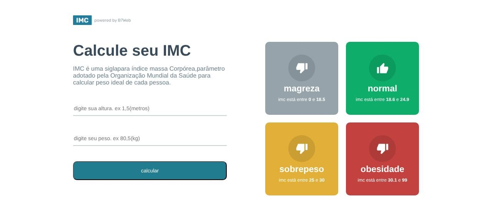

# calc-de-imc

[English](README.md)

Calculadora de IMC feita com React e TypeScript durante um curso da B7Web.

> **Tipo:** projeto de estudo (2023)



## Funcionalidades

- Campos de altura (m) e peso (kg); calcula IMC = peso / altura².
- Mostra o cartão da faixa correspondente (magreza, normal, sobrepeso, obesidade) com o seu IMC.
- Seta de voltar para limpar o resultado e recomeçar.
- Interface em português.

## Tecnologias

React 18, TypeScript 4.9, CSS Modules, Create React App (`react-scripts` 5). O app fica na pasta `react_calc_imc/`.

## Como rodar

Requer Node.js (verificado com Node 22) e npm.

```bash
cd react_calc_imc
npm ci
npm start        # servidor de desenvolvimento em http://localhost:3000
npm run build    # build de produção em react_calc_imc/build/
```

## Estrutura

- `react_calc_imc/src/App.tsx`: formulário e tela de resultado.
- `react_calc_imc/src/helpers/imc.ts`: faixas e cálculo do IMC.
- `react_calc_imc/src/components/GridItem/`: cartão de cada faixa.

## Limitações

- As faixas têm pequenos intervalos sem cobertura (por exemplo 18,5–18,6 e 24,9–25); um IMC nesses intervalos não mostra resultado.
- Sem testes automatizados.
- Ferramental antigo do Create React App: o `npm audit` ainda aponta alertas altos/moderados em dependências de build e do servidor de desenvolvimento, sem correção compatível dentro do `react-scripts` 5. Eles não afetam o build estático gerado.
- Apenas para estudo; não é orientação médica.

## Créditos

Desenvolvido durante um curso da [B7Web](https://b7web.com.br); o logo "powered by B7Web" vem do material do curso.

## Segurança

Veja [SECURITY.md](SECURITY.md).

## Licença

Ainda não há licença definida; todos os direitos reservados ao autor.
